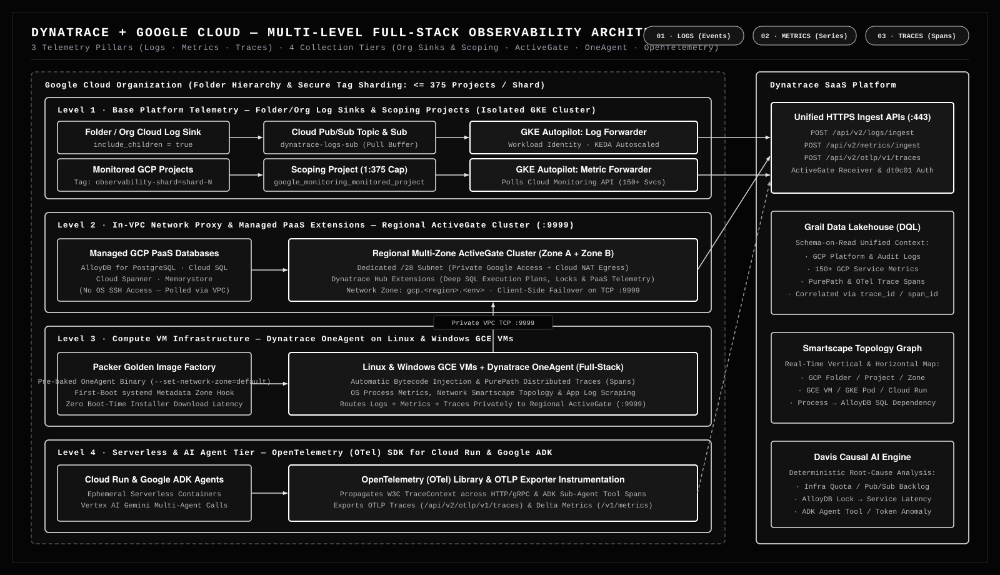

# Dynatrace + Google Cloud: Enterprise Full-Stack Observability

An end-to-end, production-grade reference architecture and Terraform/Helm automation suite for collecting **Logs**, **Metrics**, and **Distributed Traces** out of a Google Cloud Organization into **Dynatrace**.



---

## 1. The Three Core Telemetry Data Types in Google Cloud

Observability across cloud infrastructure and modern applications relies on three foundational telemetry signals. Understanding what each signal captures—and where it originates inside a Google Cloud Organization—determines how you architect collection at scale:

| Telemetry Pillar | What It Is | Examples in Google Cloud | Primary Use Case in Dynatrace |
| :--- | :--- | :--- | :--- |
| **1. Logs** | Discrete, timestamped text or structured JSON records describing specific events that occurred in infrastructure or application code. | • GCP Cloud Audit Logs (`cloudaudit.googleapis.com`)<br>• VPC Flow Logs & Cloud NAT logs<br>• Load Balancer access logs<br>• Application `stdout`/`stderr` & stack traces | Forensic root-cause analysis, security auditing, and log-to-trace correlation in **Dynatrace Grail** using DQL. |
| **2. Metrics** | Aggregated numerical time-series measurements collected at regular intervals to represent utilization, throughput, or saturation. | • GCE/GKE CPU & memory utilization<br>• Pub/Sub unacknowledged message backlog<br>• AlloyDB / Cloud SQL lock waits & IOPS<br>• HTTP request rate, error rate, and p95/p99 latency | Real-time health dashboards, SLO monitoring, capacity planning, and anomaly detection via **Davis Causal AI**. |
| **3. Traces** | End-to-end distributed request waterfalls composed of nested **spans** (`trace_id` / `span_id`) tracking a single request across services. | • Incoming HTTPS request $\rightarrow$ Cloud Run API $\rightarrow$ GCE VM microservice $\rightarrow$ AlloyDB SQL query<br>• Google ADK / Vertex AI Gemini multi-agent reasoning & tool invocation spans | Pinpointing exact code-level latency bottlenecks, broken downstream dependencies, and N+1 database queries (**PurePath** & **OpenTelemetry**). |

---

## 2. Multi-Level Integration Architecture: Collecting Telemetry Across a GCP Organization

No single collector can capture every signal across managed cloud control planes, virtual machines, managed databases, and serverless containers. This repository implements a **four-level defense-in-depth observability architecture**:

### Level 1: Base Platform & Organization Telemetry (Cloud Logging Sinks & Cloud Monitoring Scoping Projects)
At the foundational cloud layer, you need visibility into every GCP service across hundreds of projects **without deploying agents into every project**:
- **Organization / Folder Log Sink $\rightarrow$ Cloud Pub/Sub $\rightarrow$ GKE Log Forwarder**:
  A single aggregated Cloud Logging Sink configured at the GCP Folder or Organization level (`include_children = true`) captures platform and audit logs across all child projects and routes them into a central Cloud Pub/Sub topic (`dynatrace-logs-topic`). A KEDA-autoscaled **Dynatrace Log Forwarder** running on an isolated, private **GKE Autopilot** cluster pulls messages via Workload Identity and streams them to Dynatrace (`/api/v2/logs/ingest`).
- **Cloud Monitoring Scoping Project $\rightarrow$ GKE Metric Forwarder**:
  Application and workload projects are attached via `google_monitoring_monitored_project` to a central **Cloud Monitoring Scoping Project**. The **Dynatrace Metric Forwarder** pod on the isolated GKE cluster queries the Scoping Project's Cloud Monitoring API (`monitoring.timeSeries.list`) using Workload Identity to ingest metrics for 150+ GCP services into Dynatrace (`/api/v2/metrics/ingest`).
- **Why an Isolated "Island" GKE Cluster?**:
  The GKE Autopilot cluster hosting the Log and Metric Forwarders runs in a dedicated observability project and VPC with **zero VPC peering** required to application networks. All collection happens over Google's control-plane APIs via Private Google Access.

### Level 2: In-VPC Network Proxy & Managed PaaS Extensions (Regional ActiveGate Cluster)
For workloads running inside private VPCs—and for managed GCP PaaS resources where OS-level SSH access is impossible—a **Regional Multi-Zone ActiveGate Cluster** acts as an in-VPC proxy and extension execution engine:
- **Multi-Zone High Availability & Client-Side Failover**:
  Deployed via Terraform across multiple availability zones (e.g., Zone A and Zone B) inside a dedicated `/28` subnet (`<vpc>-activegate-sub`) with Private Google Access and Cloud NAT egress. Both ActiveGates register under a shared Dynatrace **Network Zone** (`gcp.<region>.<env>`), enabling OneAgents to automatically load-balance and fail over on TCP port `9999` without an internal TCP load balancer.
- **Managed GCP PaaS Observability (AlloyDB, Cloud SQL, Spanner)**:
  Because you cannot install an OS agent on managed databases like **AlloyDB for PostgreSQL** or **Cloud SQL**, the ActiveGate runs **Dynatrace Hub Extensions** that connect privately over the VPC to capture deep query execution plans, lock contention, vacuum health, and connection pool saturation.

### Level 3: Compute VM Level — Linux & Windows GCE VMs (Dynatrace OneAgent + Golden Image Factory)
When workloads run on Linux or Windows Google Compute Engine (GCE) VMs, **Dynatrace OneAgent** provides deep, zero-code full-stack instrumentation:
- **Automatic Logs, Metrics, and PurePath Distributed Traces**:
  OneAgent operates at the OS and runtime level, automatically discovering processes, building the real-time **Smartscape** topology graph, scraping application log files, and injecting bytecode into Java, Go, Node.js, Python, and .NET processes to capture end-to-end **PurePath distributed traces** paired with exact SQL statements and method hotspots.
- **Private Routing via ActiveGate**:
  Workload VMs require **no public IPs and no direct internet egress**. All OneAgent traffic routes privately over VPC firewall rules (`tcp:9999`) to the regional ActiveGate cluster.
- **Packer Golden Image Factory (`pipelines/image_factory/`)**:
  Instead of downloading the OneAgent installer on every VM boot, our Packer pipeline pre-bakes the OneAgent binary into hardened Ubuntu/Windows Golden Images (`--set-network-zone=default` at build time) and installs a lightweight `systemd` first-boot service (`dynatrace-zone-config.service`) that reads the VM's GCP region/custom metadata and dynamically binds `--set-network-zone=gcp.<region>.<env>` in milliseconds.

### Level 4: Serverless, Cloud Run & AI Agent Level (OpenTelemetry / OTel SDK Instrumentation)
For ephemeral serverless containers (**Cloud Run**, Cloud Functions) and modern **AI Agent applications** built with **Google ADK (Agent Development Kit)** and **Vertex AI Gemini**, host-level kernel agents cannot be installed and custom semantic spans are critical:
- **OpenTelemetry (OTel) SDK & OTLP Exporter**:
  Applications import the standard OpenTelemetry libraries (`opentelemetry-sdk`, `opentelemetry-exporter-otlp-proto-http`) to instrument HTTP/gRPC handlers, LLM prompt/completion calls, token usage metrics, and sub-agent tool invocations.
- **Direct OTLP Ingestion into Dynatrace**:
  Traces and metrics are exported via standard W3C TraceContext and OTLP (`POST /api/v2/otlp/v1/traces` and `/api/v2/otlp/v1/metrics`) directly to the Dynatrace SaaS ingest endpoint (or routed through the regional ActiveGate), seamlessly linking serverless Cloud Run and AI Agent spans with downstream GCE OneAgent PurePaths and AlloyDB queries inside Dynatrace Grail.

```python
# Example: OpenTelemetry (OTel) OTLP Trace Exporter targeting Dynatrace for Cloud Run / Google ADK Agents
import os
from opentelemetry import trace
from opentelemetry.sdk.resources import Resource
from opentelemetry.sdk.trace import TracerProvider
from opentelemetry.sdk.trace.export import BatchSpanProcessor
from opentelemetry.exporter.otlp.proto.http.trace_exporter import OTLPSpanExporter

resource = Resource.create({
    "service.name": os.environ.get("K_SERVICE", "adk-gemini-agent"),
    "cloud.provider": "gcp",
    "cloud.platform": "gcp_cloud_run",
})

provider = TracerProvider(resource=resource)
otlp_exporter = OTLPSpanExporter(
    endpoint=f"{os.environ['DT_ENV_URL']}/api/v2/otlp/v1/traces",
    headers={"Authorization": f"Api-Token {os.environ['DT_API_TOKEN']}"},
)
provider.add_span_processor(BatchSpanProcessor(otlp_exporter))
trace.set_tracer_provider(provider)
```

---

## 3. Enterprise Scale & Governance at Organization Level

Deploying observability across a large GCP Organization introduces structural platform constraints that this repository solves out of the box:

1. **Sharding Around GCP's 375-Project Cloud Monitoring Limit (`governance/tags/`)**:
   Google Cloud enforces a hard quota of **375 Monitored Projects per Cloud Monitoring Scoping Project**. To scale to thousands of GCP projects, this architecture uses **GCP Organization Secure Tags** (`observability-shard = shard-1`, `shard-2`, etc.) to deterministically shard projects across multiple Scoping Projects (`obs-scoping-shard-1`, `obs-scoping-shard-2`), each paired with a dedicated Metric Forwarder deployment.
2. **Preventative Custom Organization Policies (`governance/policies/`)**:
   - [`require_observability_scoping_tag.yaml`](governance/policies/require_observability_scoping_tag.yaml): Blocks creation of new GCP projects unless they carry a valid `observability-shard` tag binding.
   - [`require_activegate_subnet_in_workload_vpc.yaml`](governance/policies/require_activegate_subnet_in_workload_vpc.yaml): Enforces network readiness for regional ActiveGate deployments across spoke VPCs.
3. **Zero-Touch Project Factory CI/CD (`pipelines/project_factory_pipeline.yaml`)**:
   Automates project creation, Secure Tag binding, and `google_monitoring_monitored_project` enrollment so every new project is automatically monitored within 60 seconds of provisioning (`include_children = true` covers logs automatically).

---

## 4. Repository Structure

```text
.
├── bootstrap/
│   ├── bootstrap.env.example         # Template for environment variables & secrets (copy to bootstrap.env)
│   └── bootstrap.sh                  # Creates GCP Observability Project, GCS TF state bucket, and tfvars
├── terraform/
│   ├── environments/prod/            # Root Terraform configuration orchestrating all modules
│   └── modules/
│       ├── network/                  # Isolated Observability VPC, Private Google Access & Cloud NAT
│       ├── gke/                      # Private GKE Autopilot cluster with Workload Identity enabled
│       ├── log_sink/                 # Folder/Org Cloud Logging Sink, Pub/Sub Topic/Sub & IAM
│       ├── metric_scoping/           # Cloud Monitoring Scoping Project attachments & IAM roles
│       └── activegate/               # Multi-zone ActiveGate GCE VMs, /28 subnet, NAT & firewall rules
├── helm/
│   ├── dynatrace-gcp-Monitor/        # Official Dynatrace GCP Monitor Helm chart (Logs & Metrics modes)
│   └── values/                       # Parameterized Helm values for Log Forwarder & Metric Forwarder
├── scripts/
│   ├── 00_bootstrap.sh               # Step 0: Bootstrap GCP project, APIs, and Terraform backend
│   ├── 01_deploy_infra.sh            # Step 1: Provision GKE, Pub/Sub, Log Sink, Scoping & ActiveGates
│   ├── 02_deploy_forwarders.sh       # Step 2: Deploy Log & Metric Forwarder Helm releases to GKE
│   ├── 03_install_oneagent.sh        # Step 3: Install OneAgent on target GCE VMs via IAP tunnel
│   └── 04_verify_all.sh              # Step 4: End-to-end health verification across all tiers
├── governance/
│   ├── tags/                         # Terraform for GCP Organization Secure Tags (observability-shard)
│   └── policies/                     # Custom GCP Organization Policy YAML definitions
├── pipelines/
│   ├── project_factory_pipeline.yaml # GitHub Actions workflow for automated project onboarding
│   └── image_factory/                # Packer HCL & CI workflow for pre-baked OneAgent Golden Images
└── docs/
    ├── dynatrace_gcp_architecture.svg              # Multi-level architecture diagram
    ├── infrastructure_architecture.md              # Deep-dive topology, failure domains & data flows
    ├── dynatrace_gcp_proposal.md                   # Enterprise governance, 375-project sharding & CI/CD
    ├── dynatrace-gcp-full-stack-observability-lab.md # Step-by-step hands-on lab guide
    └── dynatrace-gcp-integration-guide.md          # Manual reference guide for GKE & Dynatrace setup
```

---

## 5. Turnkey Quickstart: 5-Step Automated Deployment

This repository provides a **turnkey automation suite** that integrates any **Dynatrace SaaS Tenant** with a **Google Cloud Organization** across all four collection levels, driven by a single local configuration file ([`bootstrap/bootstrap.env`](bootstrap/bootstrap.env.example)).

### Prerequisites & Required `bootstrap.env` Assumptions
- `gcloud` CLI authenticated with Folder/Organization Admin and Project Creator permissions
- `terraform` ($\ge 1.5$), `kubectl`, `helm` ($\ge 3.12$), and `jq`
- Before running `./scripts/00_bootstrap.sh`, populate the following core parameters in `bootstrap/bootstrap.env`:

| Parameter Group | Key Variables in `bootstrap/bootstrap.env` | Assumption / Requirement |
| :--- | :--- | :--- |
| **1. GCP Org, Folders & Billing** | `GCP_ORG_ID`, `BILLING_ACCOUNT_ID`, `OBSERVABILITY_FOLDER_ID`, `SCOPING_PROJECTS_FOLDER_ID` | Existing GCP Organization and active Billing Account; `00_bootstrap.sh` creates or reuses the Observability & Scoping folders. |
| **2. Platform & Scoping Projects** | `GCP_CONTROL_PROJECT_ID`, `GCP_PLATFORM_PROJECT_ID`, `GCP_SCOPING_PROJECT_ID`, `MONITORED_PROJECT_IDS` | `00_bootstrap.sh` provisions the Control (TF state), Platform (isolated GKE + Pub/Sub), and Scoping projects, and attaches the listed `MONITORED_PROJECT_IDS`. |
| **3. Workload VPC & ActiveGate** | `WORKLOAD_PROJECT_ID`, `ACTIVEGATE_VPC_NAME`, `ACTIVEGATE_ZONES`, `ACTIVEGATE_SUBNET_CIDR`, `ACTIVEGATE_NETWORK_ZONE` | Existing workload/spoke VPC where the multi-zone ActiveGate cluster (`:9999`) and dedicated subnet will be deployed. |
| **4. Dynatrace Tenant & Token** | `DYNATRACE_URL`, `DYNATRACE_API_TOKEN` | Active Dynatrace SaaS URL (`https://<tenant>.live.dynatrace.com`) and API token (`dt0c01...`) scoped with `logs.ingest`, `metrics.ingest`, `openTelemetryTrace.ingest`, `activeGateTokenManagement.create`, and `InstallerDownload`. |

### Step 1: Configure Your Environment
Copy the example environment file and populate your GCP Organization/Folder IDs and Dynatrace credentials (`bootstrap/bootstrap.env` is gitignored to protect your secrets):

```bash
cp bootstrap/bootstrap.env.example bootstrap/bootstrap.env
vi bootstrap/bootstrap.env
```

### Step 2: Bootstrap the Observability Project & Terraform State
Creates the dedicated GCP Observability Project, enables required GCP APIs, creates a versioned GCS state bucket, and generates `backend.tf` and `terraform.tfvars`:

```bash
./scripts/00_bootstrap.sh
```

### Step 3: Provision Core Infrastructure via Terraform
Deploys the isolated Observability VPC, Private GKE Autopilot cluster, Folder-level Log Sink, Pub/Sub topic/subscription, Cloud Monitoring Scoping Project bindings, and the regional multi-zone ActiveGate cluster:

```bash
./scripts/01_deploy_infra.sh
```

### Step 4: Deploy GKE Log & Metric Forwarders via Helm
Authenticates to the private GKE Autopilot cluster and deploys two isolated Helm releases (`dynatrace-log-forwarder` and `dynatrace-metric-forwarder`) using Workload Identity:

```bash
./scripts/02_deploy_forwarders.sh
```

### Step 5: Instrument GCE VMs & Verify End-to-End Telemetry
Install Dynatrace OneAgent on target GCE workload VMs (routed via your regional ActiveGate Network Zone) and run the automated verification suite:

```bash
./scripts/03_install_oneagent.sh
./scripts/04_verify_all.sh
```

---

## 6. Deep-Dive Documentation

- [**Infrastructure Architecture & Failure Domains**](docs/infrastructure_architecture.md): Detailed breakdown of the isolated GKE Forwarder cluster, ActiveGate multi-zone failover, and private VPC routing.
- [**Enterprise Governance & Scaling Proposal**](docs/dynatrace_gcp_proposal.md): Architectural patterns for sharding past the 375-project Cloud Monitoring limit, Custom Org Policies, and Packer Golden Images.
- [**Hands-On Full-Stack Observability Lab**](docs/dynatrace-gcp-full-stack-observability-lab.md): Step-by-step walkthrough with verification commands and troubleshooting runbooks.
- [**Manual Integration Reference Guide**](docs/dynatrace-gcp-integration-guide.md): Low-level CLI reference for manual IAM, Workload Identity, and Helm configuration.
