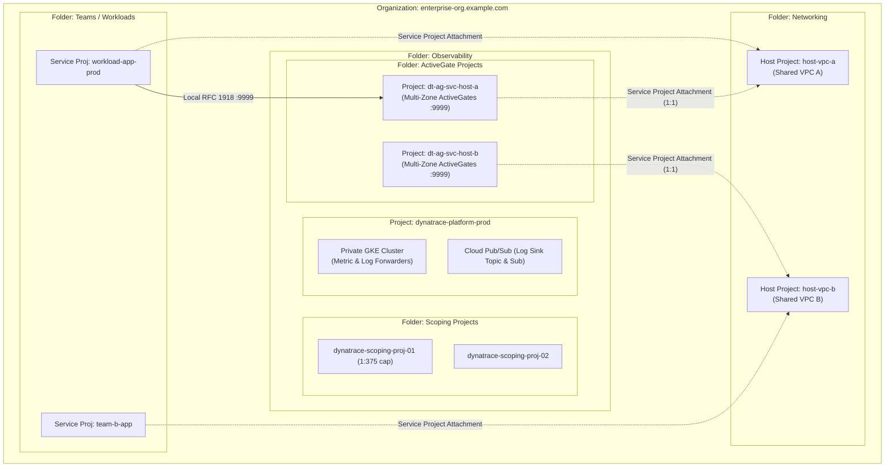
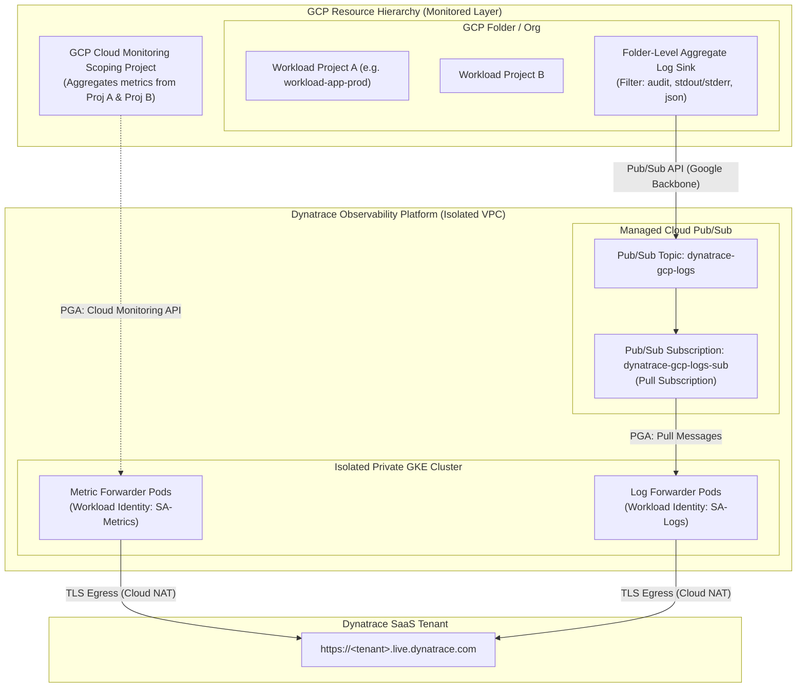
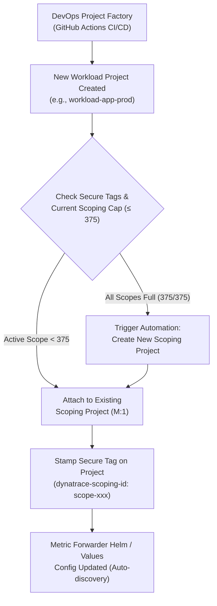

# Dynatrace + GCP Observability Platform: Architecture & Implementation Proposal

## 1. Executive Summary & Architectural Invariant Confirmation

### Question: Is having the GKE cluster sitting on an isolated "island" a disadvantage in the future?
**Answer: No, it is not a disadvantage; in fact, it is the recommended Google Cloud and Dynatrace enterprise best practice.**

Here is why:
1. **Strictly Egress/Pull-Only Workload**:
   * **Metric Forwarder**: Makes outbound REST queries to `monitoring.googleapis.com` (via Google internal backbone using Private Google Access - PGA) and pushes aggregated metrics out via HTTPS to Dynatrace SaaS (`POST https://<tenant-id>.live.dynatrace.com/api/v2/metrics/ingest`).
   * **Log Forwarder**: Pulls messages out of `pubsub.googleapis.com` over PGA and streams them out via HTTPS to Dynatrace SaaS (`POST https://<tenant-id>.live.dynatrace.com/api/v2/logs/ingest`).
   * **Zero Inbound Ingress**: Neither the Metric Forwarder nor the Log Forwarder ever exposes a public or private ingress listener for workloads. They act entirely as polling workers / queue consumers.
2. **Blast Radius & Security Isolation**:
   * Workload clusters and VMs running application code never touch the GKE control plane or node network.
   * If a workload VPC is compromised or modified, the observability ingestion pipeline remains untouched.
3. **Multi-Project / Multi-Tenant Agnostic**:
   * Because metrics are aggregated at the GCP Cloud Monitoring Scoping Project level and logs are aggregated at the Folder/Org Log Sink level into Pub/Sub, the GKE cluster does not need line-of-sight to the source projects/VPCs.
### Question 2: How does the ActiveGate dedicated subnet pattern work across Shared VPCs?
**Answer: Yes, exactly correct.**

Because GCP enforces that a **Service Project can only attach to ONE Shared VPC Host Project**, an enterprise with multiple Shared VPCs requires a strict **1:1 Service Project to Host Project mapping**:

1. **Hierarchy**:
   * Under the **Observability** folder, we maintain an **ActiveGate Projects** folder.
   * For every Shared VPC Host Project in the enterprise, there is exactly one dedicated Dynatrace Service Project:
     - `dynatrace-ag-svc-host-a` $\leftrightarrow$ attached to `host-vpc-project-a`
     - `dynatrace-ag-svc-host-b` $\leftrightarrow$ attached to `host-vpc-project-b`
2. **Within each Dynatrace Service Project**:
   * It provisions its ActiveGate clusters (MIGs + Internal NLBs on port 9999) across the regions needed for that specific Shared VPC network.
   * The NICs are allocated directly into that Host Project's `dynatrace-activegate-subnet`.
3. **Outcome**:
   * All workload Service Projects attached to `host-vpc-project-a` reach their ActiveGate at the local `host-a` internal NLB VIP.
   * Completely clean IAM boundaries, zero cross-VPC networking overhead, and 100% compliance with Google Cloud Shared VPC constraints.



### Enterprise GCP Resource Hierarchy Tree

```text
Organization: enterprise-org.example.com (123456789012)
│
├── [Folder] Observability
│   ├── [Folder] Scoping Projects
│   │   ├── [Project] dynatrace-scoping-project-01 (1:375 cap)
│   │   └── [Project] dynatrace-scoping-project-02
│   │
│   ├── [Project] dynatrace-platform-prod
│   │   ├── Dedicated VPC (for GKE Metric & Log Forwarders)
│   │   ├── Cloud Pub/Sub (Topic: dynatrace-gcp-logs, Sub: dynatrace-gcp-logs-sub)
│   │   └── Private GKE Cluster (Workload Identity)
│   │
│   └── [Folder] ActiveGate Projects
│       ├── [Project] dynatrace-ag-svc-host-a (Service Project -> Attached to host-vpc-a)
│       │   └── Multi-Zone ActiveGate Cluster (:9999)
│       └── [Project] dynatrace-ag-svc-host-b (Service Project -> Attached to host-vpc-b)
│           └── Multi-Zone ActiveGate Cluster (:9999)
│
├── [Folder] Networking
│   ├── [Project] host-vpc-project-a (Shared VPC Host A)
│   │   └── Shared VPC A (hosts subnets including dynatrace-activegate-subnet-a)
│   └── [Project] host-vpc-project-b (Shared VPC Host B)
│       └── Shared VPC B (hosts subnets including dynatrace-activegate-subnet-b)
│
└── [Folder] Teams / Workloads
    ├── [Project] workload-app-prod (Service Project -> Attached to host-vpc-a)
    │   ├── GCE VMs (OneAgent pointing to local ActiveGate Network Zone in Shared VPC A)
    │   ├── Cloud Run v2 Services (OTel Instrumented)
    │   └── PaaS resources
    └── [Project] observed-project-b (Service Project -> Attached to host-vpc-b)
        └── GCE VMs & PaaS resources
```

---

## 2. High-Level Target Architecture



---

## 3. What We Are Building

### Component 1: DevOps Project Factory Automation & Scoping Project Allocation
In an enterprise GCP estate, manual attachment of monitored projects to scoping projects is an anti-pattern and breaks the hard GCP limit of **375 monitored projects per 1 scoping project**.



* **GCP Resource Manager Secure Tags**:
  * Instead of arbitrary labels (which any project owner can tamper with or delete), we bind **Secure Tags** governed at the GCP Organization / Folder level:
    * `tagKeys/dynatrace-observability` $\rightarrow$ `tagValues/monitored`
    * `tagKeys/dynatrace-scoping-id` $\rightarrow$ `tagValues/<scoping-project-id>`
  * This creates an immutable audit trail and establishes definitive ownership of which scoping project queries this workload.
* **Project Factory CI/CD Stage (GitHub Actions)**:
  * A dedicated pipeline stage runs during project provisioning:
    1. Evaluates existing scoping projects and their current monitored project count.
    2. If the count reaches 375, automatically provisions `dynatrace-scoping-project-N` and registers it with the Dynatrace Metric Forwarder config.
    3. Executes the Google Cloud Monitoring API call:
       `gcloud monitoring metrics-scopes list / create`
    4. Stamps the Secure Tag onto the newly minted project.

### Component 2: Bootstrap Automation (`bootstrap/bootstrap.sh`)
* **GCS Terraform State Backend**:
  * Checks if the state bucket exists; if not, creates a versioned, encrypted, uniform-bucket-level-access GCS bucket.
  * Dynamically generates the root `backend.tf` configuration pointing to the bucket and environment prefix.
* **GCP APIs & Permissions Preflight**:
  * Validates current `gcloud` identity and permissions.
  * Enables mandatory APIs on target projects:
    * `container.googleapis.com` (GKE)
    * `monitoring.googleapis.com` (Cloud Monitoring)
    * `logging.googleapis.com` (Cloud Logging)
    * `pubsub.googleapis.com` (Pub/Sub)
    * `iam.googleapis.com` (Workload Identity)
    * `cloudresourcemanager.googleapis.com`

### Component 3: Infrastructure as Code (Terraform)
Directory structure:
```text
terraform/
├── environments/
│   └── prod/
│       ├── main.tf
│       ├── variables.tf
│       ├── outputs.tf
│       ├── terraform.tfvars.example
│       └── backend.tf.example
├── modules/
│   ├── networking/          # Isolated VPC + Subnet (PGA enabled) + Cloud Router / NAT
│   ├── gke_cluster/         # Private GKE Standard cluster + Workload Identity
│   ├── dynatrace_iam/       # Google SAs + IAM bindings + Workload Identity user roles
│   ├── pubsub_logging/      # Pub/Sub topic, pull subscription, and Log Sink IAM bindings
│   ├── scoping_project/     # Monitoring scoping project creation & monitored project attachment
│   └── activegate/          # Reusable multi-zone ActiveGate cluster module
```

### Component 4: Dynatrace GCP Monitor Helm Layer
* **Helm Chart Packaging**:
  * Local copy or upstream reference to `dynatrace-oss/dynatrace-gcp-monitor`.
* **Configuration Files (`values/`)**:
  * `values-metrics.yaml`:
    * Configured with target Scoping Project ID (supporting auto-discovery or multi-scoping lists).
    * Polling intervals and targeted GCP services (GCE, Cloud Run, Pub/Sub, GKE).
    * Workload Identity KSA annotations.
  * `values-logs.yaml`:
    * Configured with Pub/Sub subscription name (`projects/<project>/subscriptions/dynatrace-gcp-logs-sub`).
    * Filtering, batch size, and buffer parameters.
    * Workload Identity KSA annotations.

---

## 4. Step-by-Step Implementation Roadmap

| Phase | Description | Deliverable |
| :--- | :--- | :--- |
| **Phase 1** | **Bootstrap & State Backend** | `bootstrap/bootstrap.sh` creating GCS bucket, checking IAM, generating `backend.tf` |
| **Phase 2** | **Network & Isolated Platform VPC** | Terraform module for private VPC, subnets with Private Google Access (PGA), Cloud NAT |
| **Phase 3** | **Pub/Sub & Log Ingestion Pipeline** | Terraform module for Pub/Sub topic, subscription, dead-letter topic, and Sink writer IAM |
| **Phase 4** | **GKE Cluster & Workload Identity** | Terraform module for private GKE cluster with WLI pool configured |
| **Phase 5** | **Dynatrace Forwarders Deployment** | Helm configuration & deployment for Metric Forwarder & Log Forwarder |
| **Phase 6** | **Validation & Scoping Project Verification** | Verification script testing log flow from Pub/Sub and metric polling against Dynatrace |

