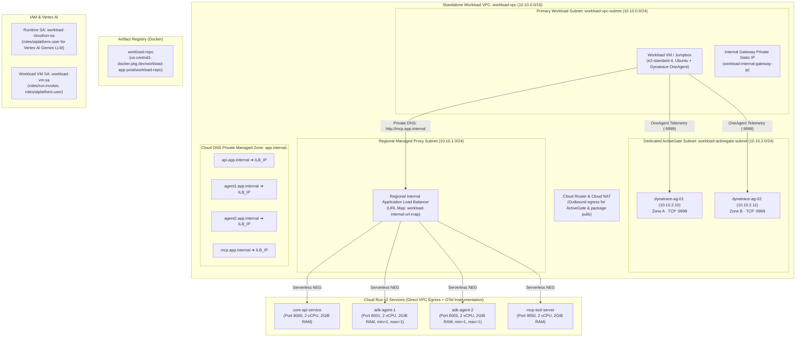

# Representative Workload Project Architecture (`workload-app-prod`)

This document renders a representative multi-service cloud workload infrastructure deployed in `workload-app-prod` (`us-central1`) demonstrating GCE VM, Cloud Run v2, and Vertex AI ADK agent telemetry collection.

---

## Architecture Diagram

---

## Component Breakdown

| Layer | Resource Name | Specs & Configuration | Role |
| :--- | :--- | :--- | :--- |
| **VPC** | `workload-vpc` | `10.10.0.0/16` isolated custom VPC | Core network boundary for observable compute & serverless services |
| **Workload Subnet** | `workload-vpc-subnet` | `10.10.0.0/24` with Private Google Access | Hosts GCE VMs (with OneAgent) and Direct VPC Egress from Cloud Run |
| **ActiveGate Subnet** | `workload-activegate-subnet` | `10.10.2.0/24` with Private Google Access | Hosts multi-zone Dynatrace ActiveGate VMs (`10.10.2.10`, `10.10.2.11`) |
| **Proxy Subnet** | `workload-vpc-proxy-subnet` | `10.10.1.0/24` (`REGIONAL_MANAGED_PROXY`) | Envoy proxies for Regional Internal Application Load Balancer |
| **Workload VM** | `workload-vm-01` | `e2-standard-4`, 50GB SSD, Ubuntu 22.04 | Monitored Linux GCE instance running Dynatrace OneAgent in Full-Stack mode |
| **Cloud DNS** | `app.internal.` | Private Managed DNS Zone | Routes internal service subdomains to internal gateway IP |
| **Load Balancer** | `workload-internal-forwarding-rule` | Regional Internal Managed HTTP Load Balancer | URL map host routing to Cloud Run Serverless NEGs on port 80 |
| **Core API Service** | `core-api-service` | Cloud Run v2 (Port 8000, 2 vCPU, 2GiB) | Core application backend instrumented with OpenTelemetry (OTLP) |
| **ADK Agent 1** | `adk-agent-1` | Cloud Run v2 (Port 8001, 2 vCPU, 2GiB) | Google ADK Gemini agent runtime exporting OTel model & tool spans |
| **ADK Agent 2** | `adk-agent-2` | Cloud Run v2 (Port 8003, 2 vCPU, 2GiB) | Secondary ADK agent runtime exporting OTel spans and metrics |
| **MCP Server** | `mcp-tool-server` | Cloud Run v2 (Port 9050, 2 vCPU, 2GiB) | FastMCP Model Context Protocol tool server |
| **Registry** | `workload-repo` | Artifact Registry Docker repository | Stores versioned container images |
| **Runtime Identity** | `workload-cloudrun-sa` | Service Account (`roles/aiplatform.user`) | Grants agents access to Vertex AI Gemini LLMs |

